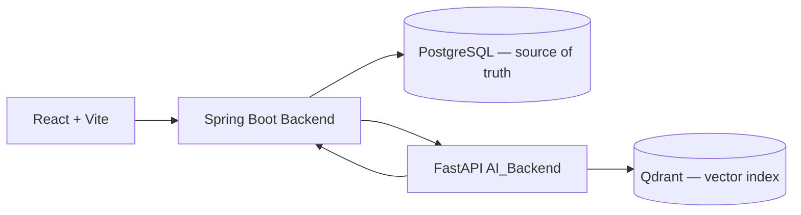

# INS — Thiết kế database cho Backend và AI_Backend

**Trạng thái:** Bản đề xuất trước đã được thay bằng [plan database tối giản](./INS-MINIMAL-DATABASE-PLAN.md), theo yêu cầu giảm bảng và vẫn tách từng loại output AI. Giữ file này làm lịch sử thảo luận; không dùng số lượng 35 bảng hoặc mô hình bảng con đã chuẩn hóa hoàn toàn làm thiết kế hiện hành.
**Cơ sở:** Schema database khởi tạo và migration `Backend/src/main/resources/db/migration/V1__ins_initial_database.sql`.

## 1. Quyết định kiến trúc

PostgreSQL là nguồn dữ liệu chính thức cho tài khoản, quyền sở hữu, học liệu, tài liệu, kết quả AI, tiến độ, phiên học và chat. Qdrant chỉ là chỉ mục vector có thể dựng lại từ tài liệu và metadata.

- Spring Boot Backend là service duy nhất ghi PostgreSQL: xác thực người dùng, kiểm tra quyền/quota, điều phối AI, lưu kết quả và quản lý transaction.
- FastAPI AI_Backend nhận request nội bộ, xử lý LLM/Qdrant rồi trả kết quả có cấu trúc. AI_Backend không giữ quyền sở hữu tài khoản và không ghi trực tiếp PostgreSQL.
- Frontend chỉ gọi Backend; không gọi thẳng database, Qdrant hoặc AI_Backend.

## 2. Khóa định danh và ánh xạ service

| Khái niệm | Database | Hợp đồng AI | Quy tắc |
|---|---|---|---|
| Người dùng | `users.id` | Không cần gửi cho model | Backend lấy từ phiên đăng nhập, không tin ID client gửi |
| Bộ học liệu | `study_materials.id` | `courseId` (API cũ: `course_id`) | Cùng một UUID; Backend xác thực quyền trước khi gọi AI |
| Tài liệu | `documents.id` | `documentId` (cần bổ sung cho ingestion) | Gắn `materialId` và `documentId` vào metadata mọi Qdrant chunk |
| Job | `generation_jobs.id` | `generationJobId`/idempotency key | Một ý định tạo có một ID ổn định để retry an toàn |
| Hội thoại | `conversations.id`, `messages.id` | AI nhận context cần thiết, không giữ lịch sử | Backend sở hữu transcript và citations |

PostgreSQL dùng `snake_case`; JSON API dùng `lowerCamelCase`; Python có thể giữ thuộc tính nội bộ `snake_case` nhưng serialize bằng alias camelCase. ID là UUID (chuỗi trong JSON), thời gian là `timestamptz`/ISO 8601 UTC.

## 3. Bảng nền tiếp tục sử dụng

Schema 21 bảng hiện có tiếp tục làm nền cho auth, lớp, học liệu, tài liệu, job, hội thoại, plan, subscription, cài đặt, phiên học, response và feedback. Một số bảng kết quả tổng quát hiện có sẽ được **tách/migrate** theo mục 4; đây là thay đổi so với phương án 21 bảng ban đầu.

- `generation_jobs`: trạng thái và idempotency của yêu cầu tạo.
- `documents`: nội dung trích xuất và metadata nguồn.
- `study_sessions`, `session_questions`, `question_options`, `question_responses`, `question_feedback`: snapshot câu hỏi/đáp án và kết quả của một lần học.
- `generation_sources`: các nguồn web bên ngoài của job.
- `conversations`, `messages`: lịch sử chat và citations.
- `plans`, `subscriptions`: quyền truy cập; Backend kiểm tra trước khi gọi AI.

## 4. Lưu output AI thành các bảng chuyên biệt

Không dùng một bảng chung kiểu `learning_artifacts` kèm JSONB để chứa summary, guide, flashcard, câu hỏi và quiz. Mỗi output có bảng cha riêng; các danh sách lặp lại lưu trong bảng con có thứ tự.

### Tóm tắt

- `course_summaries`: `id`, `material_id`, `generation_job_id`, `title`, `overview`, `version`, `origin`, `created_at`.
- `summary_key_points`: `id`, `summary_id`, `position`, `content`; `UNIQUE(summary_id, position)`.

Ánh xạ AI `summary.title`, `summary.overview`, `summary.key_points[]` vào bảng này và bảng con.

### Hướng dẫn học

- `study_guides`: `id`, `material_id`, `generation_job_id`, `title`, `version`, `origin`, `created_at`.
- `study_guide_steps`: `id`, `guide_id`, `position`, `content`.
- `study_guide_tips`: `id`, `guide_id`, `position`, `content`.

Mỗi bảng con có `UNIQUE(parent_id, position)`; AI `steps[]` và `tips[]` được lưu thành các hàng, không JSON array.

### Flashcard

- `flashcard_sets`: `id`, `material_id`, `generation_job_id`, `title`, `version`, `origin`, `created_at`.
- `flashcards`: `id`, `flashcard_set_id`, nullable `document_id`, `front`, `back`, `source_page`, `position`, `created_at`.
- `flashcard_progress`: `user_id`, `flashcard_id`, `level`, `review_count`, `correct_count`, `last_reviewed_at`, `next_review_at`.

Migrate `terms` thành `flashcards` và `term_progress` thành `flashcard_progress`, bảo toàn ID/tiến độ nếu database đã có dữ liệu. Sau chuyển đổi, không duy trì hai bảng thẻ trùng nhau.

### Câu hỏi ôn tập

- `study_question_sets`: `id`, `material_id`, `generation_job_id`, `title`, `version`, `origin`, `created_at`.
- `study_questions`: `id`, `set_id`, `position`, `type`, `prompt`, `hint`, `core_knowledge`, nullable `correct_answer`.
- `study_question_options`: `id`, `question_id`, `position`, `content`.
- `study_question_pairs`: `id`, `question_id`, `position`, `term`, `definition`.

`type` là `multiple_choice` hoặc `matching`. Multiple-choice cần đúng 4 options, một correct answer khớp option và không có pairs. Matching cần ít nhất một pair, không có options/correct answer. Database giữ CHECK khả thi; service validate các quy tắc liên hàng.

### Quiz

- `quizzes`: `id`, `material_id`, `generation_job_id`, `title`, `version`, `origin`, `created_at`.
- `quiz_questions`: `id`, `quiz_id`, `position`, `prompt`, `explanation`.
- `quiz_question_options`: `id`, `question_id`, `position`, `content`, `is_correct`.

Mỗi quiz question có 4 options và chính xác một đáp án đúng (service validate; partial unique index chặn nhiều hơn một). Khi bắt đầu làm quiz, Backend snapshot câu hỏi/options vào bảng session hiện có; chỉnh sửa đề về sau không đổi phiên cũ.

### Podcast và nguồn tài liệu

- Đổi `learning_artifacts` thành `podcasts`, chỉ giữ trường podcast/audio.
- Đổi `artifact_sources` thành `podcast_sources` nếu các hàng hiện tại thực sự chỉ trỏ podcast; nếu đã dùng cho guide/summary, migrate liên kết trước khi đổi.
- Thêm `generation_document_sources(job_id, document_id)` để ghi các tài liệu đầu vào của một job. Giữ `generation_sources` cho nguồn web, không trộn hai loại nguồn.

### Quan hệ và phiên bản

- Mỗi bảng output cha có `material_id`, `generation_job_id`, `version`, `origin`, `created_at`; FK ghép `(material_id, generation_job_id)` bảo đảm job thuộc đúng học liệu.
- Unique version theo material và loại output; mỗi lần tạo mới tăng version, không ghi đè lịch sử.
- Một job `course_materials` có thể tạo summary, guide, flashcard set và study question set cùng lúc. Job đơn lẻ dùng loại `summary`, `guide`, `flashcards`, `study_questions`, `quiz`, `podcast` hoặc `topic_lesson`.
- Không lưu cấu trúc chính của các output trong JSONB. JSONB chỉ dành cho dữ liệu snapshot/linh hoạt đã được duyệt như `messages.citations` hoặc settings snapshot.

Schema mới dự kiến có **35 bảng**: thay hai bảng generic (`learning_artifacts`, `artifact_sources`) bằng hai bảng podcast chuyên biệt, và thêm bảng cha/con cho summary, guide, flashcard, study questions, quiz cùng nối document-job. Số cuối cần kiểm tra lại khi viết migration và rà các bảng hiện có; 21 là schema nền trước yêu cầu tách output.

## 5. Luồng lưu một yêu cầu AI

1. Frontend gửi `materialId` và yêu cầu tạo tới Backend.
2. Backend xác thực user, quyền sở hữu material, document, quota và input; tạo `generation_jobs` ở trạng thái `queued` với idempotency key rồi commit.
3. Backend gọi AI_Backend nội bộ với `generationJobId`, `materialId`, `documentId` và nội dung/tài liệu theo hợp đồng. Không gửi đường dẫn file cục bộ tùy ý.
4. Backend chuyển job sang `running`; validate response AI theo contract camelCase/schema; transaction lưu output vào các bảng chuyên biệt và chuyển job sang `succeeded`.
5. Khi lỗi, lưu `failed` cùng mã lỗi không nhạy cảm. Retry cùng key/payload trả cùng job; cùng key nhưng payload khác bị từ chối.

Cuộc gọi LLM/Qdrant không nằm trong transaction PostgreSQL. AI_Backend cần xử lý idempotency/retry, hoặc Backend cần reconciliation cho tình huống AI đã xong nhưng Backend dừng trước khi lưu.

## 6. Quy tắc quyền và dữ liệu

- Chỉ Backend có credential ghi PostgreSQL. AI_Backend chỉ truy cập Qdrant và API LLM; Frontend không truy cập trực tiếp hai backend service.
- UUID không phải bằng chứng quyền. Backend luôn scope theo user đăng nhập và material owner.
- Khi ingest, mỗi Qdrant chunk có `materialId` và `documentId`; xóa/re-index theo document phải đồng bộ với thao tác tài liệu PostgreSQL.
- File thật lưu trong object/file storage; `documents.file_path` chứa key/URI ổn định. `extracted_text` là nguồn để dựng lại Qdrant.
- Hiện AI_Backend chưa có web search cho chế độ `requirement`; không tạo `generation_sources` giả. Khi thêm web search, ghi từng nguồn thật tại `generation_sources`.
- Backend lưu hội thoại và câu trả lời hoàn chỉnh sau SSE `done`; AI_Backend không lưu lịch sử chat.

## 7. Kế hoạch triển khai sau khi duyệt

| Bước | Công việc | Kiểm tra/bàn giao |
|---|---|---|
| 1 | Duyệt tên bảng, field, enum, version và cách lưu từng output | Data dictionary/API contract |
| 2 | Kiểm tra Flyway history và dữ liệu hiện tại; viết migration additive để tạo bảng chuyên biệt, backfill rồi đổi tên/deprecate bảng cũ | Nâng cấp từ database hiện có, không sửa V1 đã chạy |
| 3 | Tạo repository/service Spring Boot lưu từng output trong transaction | FK, unique/check, version, rollback |
| 4 | Bổ sung hợp đồng AI `materialId`/`documentId`, JSON camelCase và metadata Qdrant | Schema validation, isolation, re-index/xóa |
| 5 | Nối Backend orchestration với AI và Frontend | E2E tạo tài liệu → lưu → hiển thị từng output |
| 6 | Kiểm thử quyền, retry, lỗi giữa chừng, snapshot quiz, progress và citations | Báo cáo tích hợp; mock LLM trong test thường |
| 7 | Kiểm tra backup/restore và hướng dẫn chạy ba service | Runbook bàn giao |

**Chưa thực hiện:** tạo migration, sửa source code, chạy PostgreSQL hoặc chuyển dữ liệu. Khi duyệt thiết kế, bước tiếp theo là viết data dictionary chi tiết và migration plan/backfill cho các bảng đang có.
