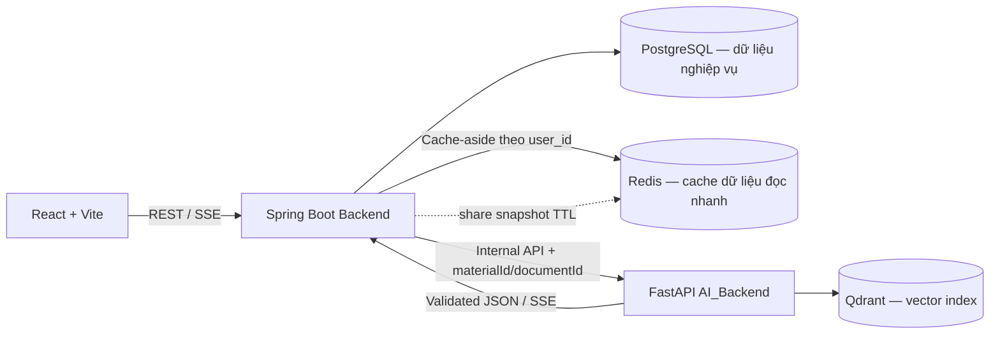
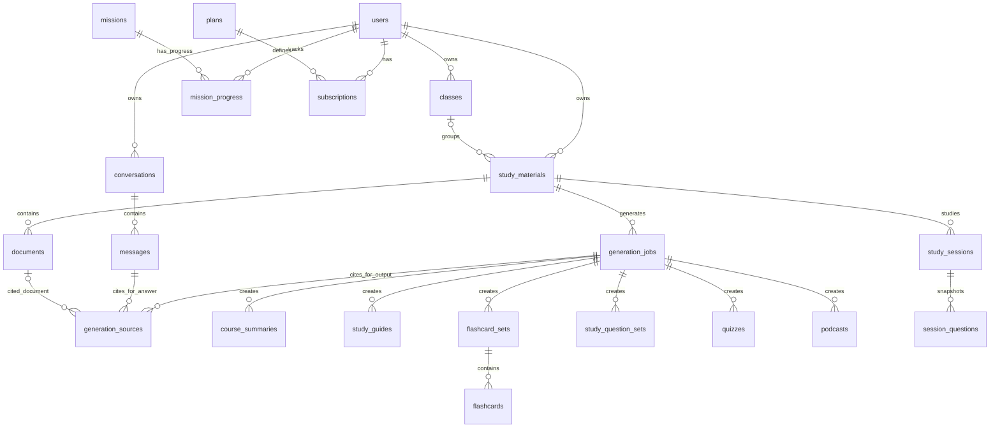

# INS — Kế hoạch database PostgreSQL tối giản

**Trạng thái:** Phương án 19 bảng đã được duyệt; sau đó bổ sung `generation_sources`, `missions` và `mission_progress`, tổng cộng 22 bảng. Migration khởi tạo duy nhất V1 đã được chạy trên PostgreSQL 16 tạm, qua Flyway và Hibernate validation; database thật chưa khởi tạo. Dữ liệu demo localStorage sẽ bị loại bỏ, không import vào PostgreSQL. Redis cache dữ liệu sau đăng nhập đã được bổ sung vào kế hoạch; chưa triển khai trong Backend.
**Mục tiêu:** Thiết kế một database dùng được cho Frontend, Spring Boot Backend và AI_Backend; lưu riêng từng loại output AI, đồng thời giảm số bảng và quan hệ không cần thiết.
**Cơ sở đã kiểm tra:** Backend hiện có migration PostgreSQL 21 bảng; AI_Backend sinh summary, study guide, flashcards, study questions, quiz riêng và chat streaming; Frontend có tài khoản, lớp, bộ học liệu, tài liệu, thẻ, học thông minh, quiz, chat, trang Plus và dữ liệu localStorage.

## 1. Nguyên tắc thiết kế

1. PostgreSQL là nguồn dữ liệu chuẩn. Chỉ Spring Boot Backend được ghi PostgreSQL; AI_Backend nhận yêu cầu nội bộ, gọi LLM/Qdrant và trả kết quả; Frontend chỉ gọi Backend.
2. Qdrant là chỉ mục vector, không phải nơi lưu học liệu duy nhất. Mỗi vector gắn `material_id` và `document_id` để truy xuất hoặc xóa theo phạm vi.
3. Mỗi loại output AI có bảng riêng: summary, guide, flashcard, study questions, quiz và podcast. Không gom các loại này vào một bảng generic.
4. Để giảm bảng, mảng ít cần truy vấn độc lập (key points, steps/tips, câu hỏi) được lưu JSONB trong đúng bảng chuyên biệt của loại nội dung đó. Flashcard được lưu từng hàng vì cần theo dõi tiến độ từng thẻ.
5. `generation_sources` lưu riêng nguồn web/tài liệu dùng để tạo nội dung hoặc trả lời chat, giúp truy nguyên và dẫn chứng. Các bảng nguồn và output vẫn có kiểu riêng; không gộp mọi output vào bảng generic.
6. Chỉ giữ dữ liệu phục vụ chức năng hiện có hoặc đã được yêu cầu. Không thêm payment ledger, permission sharing hay bảng `plan_features` riêng.
7. Dùng UUID; API JSON camelCase; SQL snake_case; thời gian PostgreSQL `timestamptz`, API ISO 8601 UTC.

## 2. Kiến trúc dữ liệu

Backend xác thực user, kiểm tra sở hữu học liệu/plan/quota, tạo job và lưu output. AI_Backend không nhận quyền ghi database; Qdrant chỉ giữ vectors và metadata. Redis phục vụ hai mục đích độc lập: cache dữ liệu đọc thường dùng và giữ snapshot chia sẻ có TTL. Snapshot chia sẻ hết hạn thì không ảnh hưởng PostgreSQL; người nhận thêm bản sao, Backend tạo bản ghi PostgreSQL mới. Bản sao chỉ gồm nội dung; không sao chép dữ liệu học tập hoặc lịch sử của chủ cũ.

### 2.1. Cache dữ liệu sau đăng nhập

- Frontend vẫn gọi Backend sau khi đăng nhập; không kết nối trực tiếp Redis. JWT/cookie xác định `user_id`, Backend dùng ID đó để lấy cache, vì vậy cache dùng lại được qua các phiên đăng nhập khác nhau của cùng tài khoản.
- Dùng cache-aside: Backend đọc Redis trước; cache hit thì trả dữ liệu, cache miss thì đọc PostgreSQL rồi ghi kết quả vào Redis. PostgreSQL vẫn là nguồn dữ liệu chuẩn. Nếu Redis lỗi, Backend tiếp tục đọc PostgreSQL để request vẫn hoạt động.
- Đề xuất endpoint tổng hợp `GET /api/bootstrap` chỉ trả dữ liệu cần dựng trang chủ: tên hiển thị, avatar ID và level tối thiểu cho header; danh sách lớp (ID, tên, màu); danh sách bộ học liệu (ID, tiêu đề, ngày tạo/sửa, lớp, màu lớp và `deletedAt` để lọc trạng thái đã xóa). Không đưa tiến độ nhiệm vụ, gói Plus, hồ sơ đầy đủ hoặc nội dung tài liệu/học tập vào payload này.
- Dùng khóa có namespace/version và phạm vi tài khoản, ví dụ `ins:v1:user:{userId}:bootstrap`; TTL mặc định đề xuất 5 phút. Không đưa mật khẩu, JWT/cookie, session secret hay nội dung tài liệu thô vào cache.
- Sau khi transaction PostgreSQL ghi thành công, Backend xóa cache bootstrap của user khi đổi tên/avatar/level, tạo/sửa/xóa lớp hoặc bộ học liệu. TTL là lớp bảo vệ bổ sung nếu một luồng chưa xóa cache.
- Redis không lưu `Idempotency-Key`; khóa chống tạo trùng và fingerprint tiếp tục nằm trong `generation_jobs` ở PostgreSQL để giữ bảo đảm sau khi Redis hết hạn hoặc khởi động lại.
- Redis là hạ tầng cache, không làm tăng số bảng nghiệp vụ và không cần migration PostgreSQL. Backend cần cấu hình Redis trong môi trường local/deploy; cache miss, eviction hoặc Redis restart không được làm mất dữ liệu người dùng.

## 3. Phương án đã duyệt: 22 bảng

### Tài khoản và thư viện

| # | Bảng | Lưu gì |
|---:|---|---|
| 1 | `users` | Tài khoản và hồ sơ cơ bản trong cùng bảng |
| 2 | `classes` | Lớp/nhóm do user sở hữu |
| 3 | `study_materials` | Bộ học liệu, owner, class tùy chọn, xóa mềm |
| 4 | `documents` | Tài liệu upload, text, URL hoặc nguồn AI tìm; trạng thái xử lý và storage key |

### Yêu cầu AI và output có kiểu riêng

| # | Bảng | Lưu gì |
|---:|---|---|
| 5 | `generation_jobs` | Một yêu cầu AI/mock: loại, prompt/input mode, trạng thái, idempotency, fingerprint, lỗi an toàn, thời gian |
| 6 | `generation_sources` | Kết quả tìm kiếm/tài liệu làm căn cứ cho job tạo nội dung hoặc câu trả lời chat |
| 7 | `course_summaries` | Summary theo version: title, overview, `key_points JSONB` |
| 8 | `study_guides` | Hướng dẫn theo version: title, `steps JSONB`, `tips JSONB` |
| 9 | `flashcard_sets` | Bộ thẻ theo version: title/topic, generation job |
| 10 | `flashcards` | Mỗi thẻ một hàng: front/back, source, vị trí và tiến độ ôn tập |
| 11 | `study_question_sets` | Set câu hỏi học tập theo version; `questions JSONB` chứa MCQ/matching đã validate |
| 12 | `quizzes` | Bài quiz theo version; `questions JSONB` chứa câu hỏi, options, correct answer, explanation |
| 13 | `podcasts` | Script, metadata và audio storage key cho tính năng podcast/Plus |

### Học, hội thoại và gói tài khoản

| # | Bảng | Lưu gì |
|---:|---|---|
| 14 | `study_settings` | Tùy chỉnh học riêng theo user/material |
| 15 | `study_sessions` | Phiên smart study, flashcard hoặc quiz; trạng thái, cấu hình snapshot, thời gian, điểm tổng |
| 16 | `session_questions` | Mỗi câu của phiên: snapshot JSONB, câu trả lời, kết quả, thời lượng, feedback |
| 17 | `conversations` | Hội thoại theo user/material |
| 18 | `messages` | Tin nhắn và generation mode; nguồn dẫn chứng liên kết qua `generation_sources` |
| 19 | `missions` | Nhiệm vụ cố định dùng chung; tiêu chí, ngưỡng, điểm thưởng và chính sách lặp |
| 20 | `mission_progress` | Tiến độ, lần hoàn thành và điểm đã nhận của từng user cho mỗi nhiệm vụ |
| 21 | `plans` | Free/Plus, giá, chu kỳ và `features JSONB` |
| 22 | `subscriptions` | Lịch sử đăng ký của user và trạng thái gói |

Schema đích có 22 bảng: phương án tối giản 19 bảng đã duyệt, cộng `generation_sources` cho provenance/citations, `missions` cho tiêu chí nhiệm vụ toàn hệ thống và `mission_progress` cho tiến độ cá nhân. Catalog khởi tạo gồm [24 nhiệm vụ dùng chung](./INS-MISSIONS-CATALOG.md). Điểm và level tích lũy lưu trên `users`.

## 4. Khung trường chính

Các kiểu dưới đây là đề xuất PostgreSQL; chi tiết nullability, CHECK và index sẽ được ghi trong data dictionary trước khi viết migration.

### Bảng nghiệp vụ

- `users`: `id UUID PK`, `email CITEXT UNIQUE`, `password_hash TEXT`, `display_name TEXT`, `avatar_id TEXT NULL`, `experience_points BIGINT NOT NULL DEFAULT 0`, `level INTEGER NOT NULL DEFAULT 1`, `status TEXT`, `created_at`, `updated_at`. `avatar_id` là mã avatar PNG có sẵn; Backend kiểm tra level mở khóa trước khi cập nhật. Level được tính ở Backend từ điểm kinh nghiệm.
- `classes`: `id UUID PK`, `owner_id UUID FK`, `name TEXT`, `color TEXT`, `created_at`; unique `(owner_id, name)`.
- `study_materials`: `id UUID PK`, `owner_id UUID FK`, `class_id UUID NULL`, `title TEXT`, `description TEXT NULL`, `created_at`, `updated_at`, `deleted_at NULL`. Ràng buộc bảo đảm class và material cùng owner.
- `documents`: `id UUID PK`, `material_id UUID FK`, `generation_job_id UUID NULL`, `title TEXT`, `source_type TEXT`, `source_url TEXT NULL`, `storage_key TEXT NULL`, `extracted_text TEXT`, `processing_status TEXT`, `error_message TEXT NULL`, timestamps. Không lưu đường dẫn máy cá nhân hoặc bytes file trong DB.
- `generation_jobs`: `id UUID PK`, `requester_id UUID FK`, `material_id UUID FK`, `job_type TEXT`, `input_mode TEXT`, `prompt TEXT`, `status TEXT`, `mode TEXT`, `idempotency_key TEXT`, `request_fingerprint TEXT`, `started_at NULL`, `completed_at NULL`, `error_code NULL`, `created_at`. Tài liệu đầu vào và nguồn tìm được được liên kết bằng `generation_sources`.
- `generation_sources`: `id UUID PK`, `generation_job_id UUID NULL FK`, `message_id UUID NULL FK`, `document_id UUID NULL FK`, `source_type TEXT CHECK ('web','document')`, `title TEXT`, `url TEXT NULL`, `excerpt TEXT NULL`, `is_mock BOOLEAN`, `retrieved_at TIMESTAMPTZ`. CHECK buộc đúng một trong `generation_job_id`/`message_id` có giá trị; `document_id` tùy chọn tham chiếu tài liệu nội bộ. Lưu URL, tiêu đề và đoạn trích làm bằng chứng; không tự suy diễn nguồn khi AI không trả nguồn.

### Bảng output AI

- `course_summaries`: `id UUID PK`, `material_id UUID FK`, `generation_job_id UUID FK`, `title TEXT`, `overview TEXT`, `key_points JSONB`, `version INTEGER`, `origin TEXT`, `created_at`; unique `(material_id, version)`.
- `study_guides`: `id UUID PK`, `material_id UUID FK`, `generation_job_id UUID FK`, `title TEXT`, `steps JSONB`, `tips JSONB`, `version INTEGER`, `origin TEXT`, `created_at`; unique `(material_id, version)`.
- `flashcard_sets`: `id UUID PK`, `material_id UUID FK`, `generation_job_id UUID FK NULL`, `title TEXT`, `version INTEGER`, `origin TEXT`, `created_at`; unique `(material_id, version)`.
- `flashcards`: `id UUID PK`, `set_id UUID FK`, `document_id UUID NULL FK`, `position INTEGER`, `front TEXT`, `back TEXT`, `source_page TEXT NULL`, `level SMALLINT`, `review_count INTEGER`, `correct_count INTEGER`, `last_reviewed_at NULL`, `next_review_at NULL`, `archived_at NULL`, `created_at`; unique `(set_id, position)`. `archived_at` giữ trạng thái archive của thẻ cũ; khi chia sẻ, tạo bản sao nội dung và khởi tạo lại tiến độ cho người nhận.
- `study_question_sets`: `id UUID PK`, `material_id UUID FK`, `generation_job_id UUID FK`, `title TEXT`, `questions JSONB`, `version INTEGER`, `origin TEXT`, `created_at`; unique `(material_id, version)`.
- `quizzes`: `id UUID PK`, `material_id UUID FK`, `generation_job_id UUID FK`, `title TEXT`, `questions JSONB`, `version INTEGER`, `origin TEXT`, `created_at`; unique `(material_id, version)`.
- `podcasts`: `id UUID PK`, `material_id UUID FK`, `generation_job_id UUID FK`, `title TEXT`, `script TEXT`, `audio_key TEXT NULL`, `duration_seconds INTEGER NULL`, `version INTEGER`, `origin TEXT`, `created_at`.

`JSONB` không trộn các dạng output: `course_summaries` chỉ chứa key points; `study_guides` chỉ chứa steps/tips; `study_question_sets` chỉ chứa câu hỏi ôn tập; `quizzes` chỉ chứa quiz. API contract kiểm tra cấu trúc trước khi lưu. Nếu cần truy vấn/thống kê từng option hoặc câu hỏi thường xuyên, có thể chuẩn hóa riêng ở phiên bản sau.

### Bảng học và chat

- `study_settings`: `user_id UUID`, `material_id UUID`, `difficulty TEXT`, `question_types JSONB`, `custom_instructions TEXT`, `updated_at`; PK `(user_id, material_id)`.
- `study_sessions`: `id UUID PK`, `user_id UUID FK`, `material_id UUID FK`, `mode TEXT`, `status TEXT`, `settings_snapshot JSONB`, `score INTEGER NULL`, `started_at`, `ended_at NULL`.
- `session_questions`: `id UUID PK`, `session_id UUID FK`, `position INTEGER`, `question_snapshot JSONB`, `response JSONB NULL`, `result TEXT NULL`, `duration_ms INTEGER NULL`, `feedback_rating TEXT NULL`, `feedback_text TEXT NULL`, `answered_at NULL`; unique `(session_id, position)`. JSON snapshot chứa options/pairs và đáp án đúng tại thời điểm bắt đầu.
- `conversations`: `id UUID PK`, `user_id UUID FK`, `material_id UUID FK`, `title TEXT`, `created_at`, `updated_at`.
- `messages`: `id UUID PK`, `conversation_id UUID FK`, `sender_role TEXT`, `content TEXT`, `generation_mode TEXT`, `created_at`. Citations của assistant được truy vấn từ `generation_sources.message_id`.

### Nhiệm vụ và tiến độ cấp độ

- `missions`: `id UUID PK`, `code TEXT UNIQUE`, `title TEXT`, `description TEXT`, `metric_key TEXT`, `target_count INTEGER`, `reward_points INTEGER`, `repeat_policy TEXT CHECK ('once','repeatable')`, `is_active BOOLEAN`, `created_at`, `updated_at`. Không có `user_id`: danh mục nhiệm vụ giống nhau cho mọi tài khoản.
- `mission_progress`: `user_id UUID FK`, `mission_id UUID FK`, `progress_count INTEGER NOT NULL DEFAULT 0` (tiến độ chu kỳ hiện tại), `completion_count INTEGER NOT NULL DEFAULT 0` (số lần hoàn thành tích lũy), `rewarded_completion_count INTEGER NOT NULL DEFAULT 0`, `points_awarded_total BIGINT NOT NULL DEFAULT 0`, `last_completed_at TIMESTAMPTZ NULL`, `updated_at TIMESTAMPTZ`; PK `(user_id, mission_id)`. Backend cập nhật tiến độ và thưởng trong cùng transaction với sự kiện học hợp lệ; trạng thái đạt/đang làm hiển thị từ progress và ngưỡng trong `missions`.

### Gói dịch vụ

- `plans`: `id UUID PK`, `code TEXT UNIQUE`, `name TEXT`, `billing_cycle TEXT`, `price_minor BIGINT`, `currency CHAR(3)`, `is_demo BOOLEAN`, `features JSONB`, `created_at`.
- `subscriptions`: `id UUID PK`, `user_id UUID FK`, `plan_id UUID FK`, `status TEXT`, `starts_at`, `ends_at NULL`, `is_mock BOOLEAN`, `created_at`.

`plans.features` giữ quyền lợi/hạn mức, không giữ số lần đã dùng. Backend tính quota từ `generation_jobs` theo user/type/thời gian ở giai đoạn đầu; nếu tải truy vấn lớn mới bổ sung usage ledger.

`missions.metric_key` chỉ nhận metric có code và cách đếm được định nghĩa trong Backend, ví dụ `correct_answers`, `lessons_generated`, `lessons_completed`. Backend xác định metric từ `session_questions`, `generation_jobs` và `study_sessions`; không cho phép cấu hình SQL tùy ý. Mỗi sự kiện hợp lệ cập nhật `mission_progress`; khi chạm ngưỡng, Backend ghi nhận completion/reward, cập nhật `users.experience_points` và `users.level` trong cùng transaction, rồi trả tiến độ và avatar được mở khóa. `rewarded_completion_count` cùng cập nhật có khóa/điều kiện bảo đảm retry cùng sự kiện không cộng thưởng hai lần. Các sự kiện nguồn cần tính idempotent (ví dụ chỉ chấm lần đầu khi session-question chuyển sang answered, hoặc khi job chuyển sang succeeded). `points_awarded_total` giữ audit tổng điểm đã trao nếu cấu hình thưởng thay đổi về sau.

## 5. Quy tắc dữ liệu AI và Qdrant

| AI output | PostgreSQL đích | Lưu trữ |
|---|---|---|
| `summary` | `course_summaries` | Cột title/overview; key points là mảng chuỗi JSONB |
| `study_guide` | `study_guides` | Cột title; steps/tips là mảng chuỗi JSONB |
| `flashcards` | `flashcard_sets` + `flashcards` | Mỗi flashcard thành một hàng để cập nhật tiến độ |
| `study_questions` | `study_question_sets` | Câu hỏi typed JSONB riêng trong bảng này |
| `quiz` | `quizzes` | Câu hỏi/options/answer/explanation JSONB riêng trong bảng này |
| Chat SSE | `messages` + `generation_sources` | Lưu câu user và assistant hoàn chỉnh khi nhận `done`; lưu từng nguồn dẫn chứng với message assistant |
| Tài liệu | `documents` + Qdrant | PostgreSQL lưu nguồn và extracted text/storage key; Qdrant lưu vectors/chunk metadata |

Contract API dùng camelCase. Adapter Backend chuyển tên AI snake_case (`course_id`, `correct_answer`, `source_page`) sang schema chuẩn trước khi validate/lưu. `course_id` phải parse thành UUID đúng `study_materials.id`; mỗi chunk Qdrant mang `material_id` và `document_id`.

## 6. Quan hệ chính

## 7. Migration/backfill kế hoạch

**Quy tắc:** Flyway migration đã áp dụng không sửa nội dung; mọi thay đổi dùng migration version mới. Vì database đích chưa khởi tạo, migration V1 hiện tại là bộ khởi tạo ban đầu; trước khi áp dụng lên database đã tồn tại phải kiểm tra `flyway_schema_history`, backup database và thống kê dữ liệu thật.

1. **Chốt schema đích.** Đã duyệt 22 bảng, gồm podcast, `generation_sources`, danh mục `missions` dùng chung và `mission_progress` riêng từng user, share nội dung dạng bản sao, loại bỏ dữ liệu demo localStorage và soft-delete kèm dọn Qdrant sau.
2. **Migration mở rộng.** Tạo bảng chuyên biệt output và index/FK/CHECK; chưa xóa bảng cũ. Có thể thêm trường job metadata/API contract cần thiết.
3. **Backfill dữ liệu cũ.**
   - `learning_artifacts` → `course_summaries`, `study_guides`, `podcasts` theo `artifact_type`; chỉ chuyển summary/guide khi JSON đúng cấu trúc. Podcast giữ script/audio key. Dữ liệu lỗi vẫn nằm trong bảng legacy.
   - `terms` → tạo `flashcard_sets` theo material, chuyển mỗi term thành một flashcard; map `term_progress` sang cột progress của flashcard.
   - Dữ liệu demo quiz/ôn tập đang ở localStorage không được backfill vào PostgreSQL; khởi tạo dữ liệu mới qua ứng dụng/backend.
   - `study_sessions`/`session_questions` và `question_options`/`question_responses`/`question_feedback` → hợp vào `session_questions.question_snapshot`, `response`, `result`, `feedback_*`.
   - `artifact_sources` có artifact gắn job → `generation_sources` theo job/document; các hàng không có job tiếp tục được giữ tại `artifact_sources`, không tạo job lịch sử giả.
   - Backfill nguồn web từ `generation_sources` hiện có; chuyển `messages.citations` JSONB thành từng dòng gắn message. `generation_job_id` nullable để nguồn chat có thể chỉ gắn message.
   - `study_materials.deleted` legacy → `deleted_at`; giữ record và vector cho tới khi soft-delete được xác nhận. Worker dọn Qdrant theo `material_id`, retry lỗi và đánh dấu `vector_deleted_at` sau khi thành công; có thể dùng cột trạng thái trên `study_materials`, không cần thêm bảng.
   - `legacy_progress_baselines`: xuất/đối chiếu với tiến độ hiện tại, sau đó bỏ bảng; không tạo lịch sử học giả.
4. **Đối chiếu.** So sánh số rows trước/sau, kiểm tra FK material/owner, progress counts, output versions, câu trả lời và nguồn tài liệu. Fixture PostgreSQL 16 cho backfill V1 đã qua; database thật chưa có dữ liệu để đối chiếu.
5. **Chuyển code Backend.** Repository ghi/đọc các bảng mới; dùng transaction khi persist cả một response AI; job chỉ `succeeded` khi toàn bộ output bắt buộc đã lưu.
6. **Chuyển AI contract.** Bổ sung `documentId`, xác thực UUID, idempotency và kiểm thử filter/xóa/re-index theo material + document. AI_Backend không nhận PostgreSQL credential.
7. **Chuyển Frontend và dọn dữ liệu demo.** Sau khi các trang đã dùng Backend/PostgreSQL, xóa các key demo `thea-home-demo-v1`, `thea-study-v1:<materialId>`, `thea-profile-v1` và `ins-home-group`; không import chúng. Không xóa token/session xác thực hoặc dữ liệu localStorage ngoài danh sách demo đã xác định.
8. **Dọn schema cũ.** Sau một vòng release ổn định và backup đã restore thử, drop các bảng legacy đã đối chiếu xong; không drop `generation_sources` vì đây là bảng đích được duyệt.

## 8. Chia lát triển khai và nghiệm thu

| Giai đoạn | Phạm vi | Điều kiện hoàn tất |
|---|---|---|
| A. Data contract | Chuẩn hóa UUID, camelCase API, enum, JSON schema cho từng output | TypeScript/Java/Pydantic fixtures serialize qua lại nhất quán |
| B. Schema & migration | Tạo bảng output chuyên biệt, constraints, backfill | Migration chạy từ DB sạch và DB snapshot; dữ liệu đối chiếu khớp |
| C. AI job + summary/guide | Tạo job, gọi AI, lưu summary và guide riêng | retry/idempotency; lỗi không để output nửa chừng |
| D. Flashcard | Bộ thẻ, từng card, review progress | Add/edit/archive/review; progress tồn tại sau restart |
| E. Study questions + quiz | Lưu bank riêng, tạo session snapshot và kết quả | Quiz tạo lại không đổi phiên đã bắt đầu; điểm tính đúng |
| F. Documents + Qdrant | Upload/URL/topic, extraction, provenance và soft-delete | Search phân lập theo material/document; cleanup retry được; Qdrant có thể dựng lại |
| G. Chat + podcast + missions + plan | SSE, persist messages, `generation_sources`, điểm/level/avatar unlock, Plus limits, audio metadata | Chat stream không buffer; dẫn chứng truy nguyên được; tiến độ mission theo user và retry không cộng điểm trùng; Backend kiểm tra quota và avatar unlock |
| H. Redis cache + API bootstrap | Cache-aside cho dữ liệu hiển thị trang chủ; endpoint `GET /api/bootstrap`; invalidation sau khi PostgreSQL commit; fallback khi Redis lỗi | Phiên đăng nhập mới tải thông tin header tối thiểu, lớp và danh sách học liệu qua một request; cache cô lập theo user; Redis mất dữ liệu không làm mất dữ liệu nghiệp vụ |
| I. Share + rollout | Redis snapshot nội dung, xóa localStorage demo sau cutover, backup/restore | Link hết hạn/đã dùng đúng; bản sao chỉ mang nội dung và không lộ lịch sử/kết quả của chủ cũ; dữ liệu demo cũ được loại bỏ sau khi Backend hoạt động; rollback được |

**Tiêu chí nghiệm thu tổng:** mỗi output AI nằm ở bảng chuyên biệt; không có cột payload tổng hợp chứa mọi loại output; đúng owner/material/job; migration không sửa V1; không mất dữ liệu đã chọn giữ; test quyền, transaction, retry, snapshot và restore đều qua.

## 9. Các quyết định đã chốt và phạm vi

1. **Schema:** duyệt phương án 19 bảng ban đầu, rồi bổ sung `generation_sources`, `missions` và `mission_progress`; schema đích hiện là **22 bảng**.
2. **Chia sẻ:** chia sẻ theo snapshot/copy nội dung sang các bản ghi PostgreSQL độc lập. Có thể sao chép nội dung nguồn và học liệu gồm summary, guide, flashcard, study-question bank, quiz và nguồn dẫn chứng gắn với các nội dung này. Không sao chép podcast hoặc bất kỳ hoạt động/kết quả học nào của chủ cũ: phiên `study_sessions`, câu trả lời/kết quả/thời gian/feedback trong `session_questions`, lịch sử làm quiz/câu hỏi, lịch sử ôn flashcard, chat `conversations/messages`, hay XP/level và tiến độ nhiệm vụ của tài khoản chủ cũ. Podcast và message/chat là dữ liệu thuộc tài khoản Plus của người tạo, chỉ tài khoản đó truy cập; không đưa chúng vào share snapshot. Đáp án chuẩn nằm trong nội dung quiz/question bank được giữ; câu trả lời và điểm của lần làm cũ bị loại. Flashcard mới bắt đầu với `level = 0`, `review_count = 0`, `correct_count = 0`, `last_reviewed_at = NULL`, `next_review_at = NULL`; class mặc định `NULL` để người nhận tự xếp lớp. Owner giữ nguyên dữ liệu của bản gốc. Đây là chia sẻ bản sao; nếu sau này cần cùng sửa một material sống, tiến độ dùng chung/per-user cần thiết kế lại.
3. **Podcast và dẫn chứng:** giữ bảng `podcasts`; thêm `generation_sources` cho kết quả tìm tài liệu dùng bởi job AI và citations chat. AI_Backend hiện cần được bổ sung khả năng tìm nguồn và trả metadata nguồn; Backend chỉ lưu nguồn thực sự nhận được.
4. **LocalStorage:** dữ liệu demo cũ không cần giữ; không import. Sau khi Frontend chuyển sang PostgreSQL, xóa các key demo đã nêu. Giữ nguyên session/token đăng nhập và các key ngoài danh sách demo.
5. **Xóa học liệu:** soft-delete PostgreSQL; dọn vector Qdrant bất đồng bộ, có retry. Dữ liệu PostgreSQL còn trong thời hạn khôi phục.
6. **Avatar và nhiệm vụ:** không có avatar upload. `users.avatar_id` trỏ tới avatar PNG đóng gói trong ứng dụng; Backend xác thực level trước khi đổi avatar. `missions` chứa bộ tiêu chí/điểm cố định toàn hệ thống; `mission_progress` lưu tiến độ và thưởng từng nhiệm vụ cho từng user; XP và level lưu trên `users`.
7. **Lấy dữ liệu nhanh:** Redis cache duy nhất payload trang chủ theo `user_id`: thông tin header tối thiểu, lớp và các bộ học liệu cùng metadata cần cho thẻ/lọc/nhóm. Không cache progress, plan, tài liệu, câu hỏi, hội thoại hoặc dữ liệu học tập chi tiết trong endpoint này. TTL mặc định đề xuất 5 phút; xóa cache sau khi đổi tên/avatar/level, lớp hoặc bộ học liệu; fallback về PostgreSQL khi cache miss/lỗi. Frontend gọi `GET /api/bootstrap` sau đăng nhập; các màn hình chức năng gọi API riêng. PostgreSQL tiếp tục là nguồn chuẩn; `Idempotency-Key` vẫn lưu ở PostgreSQL.

**Trạng thái triển khai:** migration khởi tạo duy nhất hiện nằm tại `Backend/src/main/resources/db/migration/V1__ins_initial_database.sql`. V1 đã qua fixture backfill trên PostgreSQL 16 tạm và Spring Boot Flyway/Hibernate validation; database thật chưa được khởi tạo. Không drop bảng legacy ở bước này. Việc xóa key demo được thực hiện trong bước cutover Frontend.
