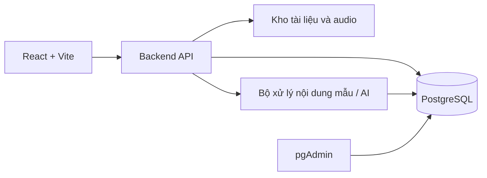
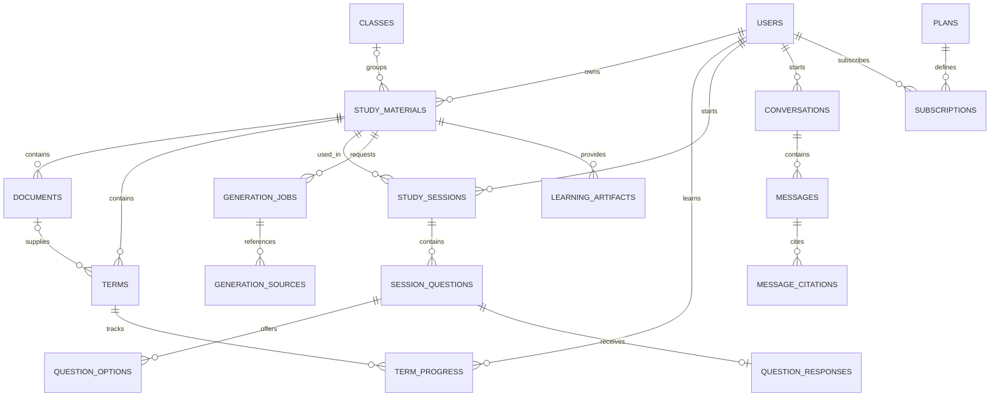

# INS — Bản thiết kế database PostgreSQL và kế hoạch triển khai

**Trạng thái:** Bản đề xuất, chờ duyệt.  
**Phạm vi tài liệu:** Thiết kế và kế hoạch; chưa phải database đã triển khai.  
**Frontend hiện tại:** React 19 + Vite + TypeScript + CSS Modules.

## 1. Mục tiêu và phạm vi

Database phục vụ các chức năng của INS: quản lý học liệu, nhập tài liệu, tạo thẻ học, luyện tập, kiểm tra, hỏi đáp, hồ sơ và gói Plus.

Giai đoạn đầu sử dụng dữ liệu giả để kiểm tra nghiệp vụ. Cấu trúc được chuẩn bị để kết nối backend và AI sau. Đây là thiết kế đề xuất từ giao diện và mã nguồn INS, không phải bản sao database nội bộ của Thea.

| Trong phạm vi thiết kế | Chưa triển khai ở giai đoạn đầu |
|---|---|
| Tài khoản và hồ sơ | Đăng nhập Google/Apple thật |
| Học liệu và tài liệu nguồn | Lớp học có giáo viên giao bài |
| Thẻ học và tiến độ | Thuật toán ôn tập nâng cao |
| Phiên học, kiểm tra, lịch sử | Chấm bài tự luận bằng AI |
| Yêu cầu sinh nội dung | Tìm tài liệu Internet bằng AI |
| Gói Plus giả lập | Thanh toán và hóa đơn thật |

## 2. Kiến trúc tổng thể



- **Frontend:** hiển thị và gửi yêu cầu, không kết nối trực tiếp PostgreSQL.
- **Backend:** xác thực, kiểm tra quyền, xử lý nghiệp vụ và chấm điểm.
- **PostgreSQL:** lưu dữ liệu có cấu trúc.
- **Kho file:** chứa PDF, DOCX và audio; database lưu đường dẫn.
- **pgAdmin:** công cụ quản trị database dành cho người phát triển, không phải trang quản trị người dùng của INS.

Môi trường local dự kiến sử dụng Docker Compose với PostgreSQL và pgAdmin; dữ liệu được lưu trên volume riêng. Phiên bản cụ thể sẽ được chốt ở bước triển khai.

## 3. Các quyết định nghiệp vụ cần duyệt

1. Một bộ học liệu có một chủ sở hữu.
2. “Lớp” là nhóm học liệu cá nhân, chẳng hạn “Sinh học 10”; chưa có danh sách học sinh.
3. Người được chia sẻ học liệu có thể đọc và luyện tập, chưa được sửa nội dung.
4. Tiến độ, lịch sử và hội thoại thuộc riêng từng người học.
5. Xóa bộ học liệu là đưa vào thùng rác; có thể khôi phục.
6. Mỗi lần làm lại bài kiểm tra tạo một phiên mới.
7. Sửa thẻ hoặc tài liệu không làm thay đổi kết quả học cũ.
8. Nội dung giả lập phải được phân biệt với nội dung AI thật.

## 4. Cấu trúc dữ liệu đề xuất

Thiết kế gồm **26 bảng nghiệp vụ**, chia thành sáu nhóm. Các bảng kỹ thuật quản lý migration, nếu có, không tính trong 26 bảng này.

### A. Tài khoản và hồ sơ — 3 bảng

| Bảng | Dữ liệu chính | Vai trò |
|---|---|---|
| `users` | ID, email, tên hiển thị, trạng thái, thời gian tạo/sửa | Tài khoản |
| `user_profiles` | Người dùng, ảnh đại diện, ngôn ngữ, trường, bậc học, lớp, vai trò học tập, múi giờ, mã hỗ trợ | Hồ sơ |
| `auth_identities` | Người dùng, nhà cung cấp đăng nhập, mã định danh, mật khẩu băm nếu có | Phương thức đăng nhập |

**Quy tắc:**

- Email không trùng, không phân biệt chữ hoa/thường sau khi chuẩn hóa.
- Một người có thể có nhiều phương thức đăng nhập.
- Thông tin “giáo viên/sinh viên” trong hồ sơ không tự cấp quyền quản trị.
- Tài khoản mẫu dùng danh tính giả lập, không seed mật khẩu thật.
- Khi hỗ trợ mật khẩu, chỉ lưu giá trị băm, không lưu mật khẩu gốc.

### B. Thư viện và tài liệu — 4 bảng

| Bảng | Dữ liệu chính | Vai trò |
|---|---|---|
| `classes` | ID, chủ sở hữu, tên lớp/môn | Nhóm học liệu |
| `study_materials` | ID, chủ sở hữu, lớp/môn, tiêu đề, thời gian tạo/sửa/xóa | Bộ học liệu trung tâm |
| `material_members` | Bộ học liệu, người được chia sẻ, thời gian cấp quyền | Quyền đọc |
| `documents` | Bộ học liệu, yêu cầu sinh nội dung nếu có, tên tài liệu, loại nguồn, văn bản trích xuất, đường dẫn file/URL, trạng thái xử lý, thông tin lỗi | Tài liệu nguồn |

Ví dụ:

```text
Người dùng An
└── Sinh học 10
    └── Bộ học liệu: Quang hợp
        ├── Tài liệu: Ghi chú bài giảng
        ├── Tài liệu: Chương quang hợp.pdf
        └── Các thẻ học được tạo từ tài liệu
```

### C. Thẻ học và nội dung được tạo — 6 bảng

| Bảng | Dữ liệu chính | Vai trò |
|---|---|---|
| `terms` | Thuật ngữ, định nghĩa, bộ học liệu, tài liệu nguồn, thời gian tạo/sửa/lưu trữ | Nội dung thẻ |
| `term_progress` | Người học, thẻ, mức ghi nhớ, số lần ôn/đúng, thời điểm ôn và lịch ôn tiếp theo | Tiến độ riêng |
| `generation_jobs` | Người yêu cầu, học liệu, loại yêu cầu, mô tả, chế độ mock/AI, trạng thái, khóa chống trùng, thời gian và lỗi | Theo dõi tạo nội dung |
| `generation_sources` | Yêu cầu, tiêu đề nguồn, URL, trích đoạn, đánh dấu mẫu, thời gian truy xuất | Nguồn tham khảo |
| `learning_artifacts` | Học liệu, yêu cầu tạo nếu có, loại hướng dẫn/tóm tắt/podcast, nội dung, phiên bản, nguồn tạo, đường dẫn audio | Sản phẩm học tập |
| `artifact_sources` | Nội dung được tạo và tài liệu đã sử dụng | Truy xuất nguồn |

Luồng **mô tả kiến thức muốn học**:

```text
Nhập mô tả
→ Tạo yêu cầu
→ Xử lý bằng dữ liệu mẫu hoặc AI
→ Lưu tài liệu và nguồn tham khảo
→ Tạo thẻ học, hướng dẫn hoặc câu hỏi
```

- Trạng thái yêu cầu: `queued → running → succeeded / failed`.
- Khi thử lại, hệ thống phải tránh tạo trùng nội dung cho cùng một yêu cầu; cùng khóa nhưng khác nội dung yêu cầu phải bị từ chối.
- Nội dung mẫu có nhãn `mock`, không được mô tả là đã tìm kiếm Internet nếu chưa thực hiện.
- `level` giữ mức 0–3 tương thích frontend hiện tại. Lịch ôn tiếp theo có thể để trống cho đến khi triển khai nhắc ôn.
- Podcast mẫu chỉ có kịch bản; không ghi đường dẫn audio nếu chưa có file thật.

### D. Luyện tập và kiểm tra — 7 bảng

| Bảng | Dữ liệu chính | Vai trò |
|---|---|---|
| `study_settings` | Người học, học liệu, độ khó, loại câu hỏi, hướng dẫn tùy chỉnh | Cài đặt học |
| `study_sessions` | Người học, học liệu, chế độ, thời gian, trạng thái, bản chụp cài đặt | Một lượt học/kiểm tra |
| `session_questions` | Phiên học, thẻ nguồn nếu có, nội dung câu hỏi, loại, thứ tự, đáp án và giải thích tại thời điểm tạo | Bản chụp câu hỏi |
| `question_options` | Câu hỏi, nội dung lựa chọn, thứ tự | Lựa chọn trắc nghiệm |
| `question_responses` | Câu hỏi, câu trả lời, kết quả, thời điểm và thời lượng trả lời | Kết quả cuối cùng |
| `question_feedback` | Câu hỏi, đánh giá tích cực/tiêu cực, góp ý | Phản hồi |
| `legacy_progress_baselines` | Người học, học liệu, tổng câu đã trả lời/đúng từ dữ liệu cũ, thời điểm nhập | Chuyển tiến độ từ localStorage |

**Vì sao cần bản chụp câu hỏi?**

Hôm nay người dùng làm câu hỏi có đáp án A. Ngày mai chủ học liệu sửa thẻ và đổi nội dung. Lịch sử hôm nay vẫn phải giữ nguyên câu hỏi, đáp án và điểm lúc làm bài.

**Quy tắc kết quả:**

- Chế độ phiên học: `smart`, `test`, `flashcards`, `matching`.
- Mỗi câu trong một phiên có một kết quả cuối cùng.
- Kết quả gồm `correct`, `incorrect`, `revealed`, `skipped`.
- Xem đáp án hoặc bỏ qua không tính là đúng.
- Một bài ghép cặp được tính là một câu; lưu chi tiết các cặp đã chọn.
- Điểm bài kiểm tra = số câu đúng / tổng số câu; đề rỗng không được bắt đầu.
- Backend chấm điểm; không tin điểm do frontend tự gửi.
- Câu trắc nghiệm có ít nhất hai lựa chọn khác nhau và đúng một đáp án đúng.
- Khi nối backend, chỉ trả đáp án đúng xuống frontend vào thời điểm người dùng được phép xem.
- Tiến độ cũ chỉ có số tổng sẽ được giữ nguyên, không dựng lịch sử giả để bù.

### E. Hỏi đáp — 3 bảng

| Bảng | Dữ liệu chính | Vai trò |
|---|---|---|
| `conversations` | Người dùng, học liệu, thời gian tạo | Hội thoại |
| `messages` | Hội thoại, người gửi, nội dung, chế độ tạo, thời gian | Tin nhắn |
| `message_citations` | Tin nhắn, tài liệu, trích đoạn | Căn cứ trả lời |

Người được chia sẻ học liệu không mặc nhiên được xem hội thoại của người khác. Câu trả lời trích xuất cục bộ được phân biệt với câu trả lời do AI tạo.

### F. Gói dịch vụ — 3 bảng

| Bảng | Dữ liệu chính | Vai trò |
|---|---|---|
| `plans` | Mã gói, tên, chu kỳ, giá, tiền tệ, đánh dấu demo | Free/Plus |
| `plan_features` | Gói, chức năng, cho phép hay không, hạn mức | Quyền lợi |
| `subscriptions` | Người dùng, gói, thời hạn, trạng thái, đánh dấu giả lập | Đăng ký gói |

Người dùng không có đăng ký Plus còn hiệu lực được áp dụng Free. Giá và quyền lợi trong dữ liệu mẫu là thông số demo, chưa phải chính sách kinh doanh chính thức.

Chưa thiết kế giao dịch, hóa đơn và webhook thanh toán trong đợt đầu. Các phần này sẽ được bổ sung khi chọn cổng thanh toán.

## 5. Quan hệ chính



Sơ đồ trên thể hiện các quan hệ trung tâm; sơ đồ vật lý chi tiết khi triển khai sẽ thể hiện đủ 26 bảng cùng khóa chính, khóa ngoại.

## 6. Quy tắc kỹ thuật và toàn vẹn dữ liệu

| Nội dung | Thiết kế |
|---|---|
| ID | UUID |
| Thời gian | `TIMESTAMPTZ`; hiển thị theo múi giờ người dùng |
| Nội dung tiếng Việt | Database UTF-8 |
| Tiền | Số nguyên theo đơn vị tiền nhỏ nhất và mã tiền tệ |
| Đáp án ghép cặp, bản chụp cài đặt | JSONB |
| File tài liệu/audio | Lưu ngoài database |
| Xóa học liệu | `deleted_at` |
| Thay đổi schema | Migration có phiên bản |

Các dữ liệu thường dùng để liên kết, lọc hoặc thống kê được lưu bằng cột và bảng quan hệ, không gom toàn bộ vào JSONB.

### Ràng buộc quan trọng

- Tài liệu, thẻ và nguồn trích dẫn phải thuộc đúng bộ học liệu.
- Lớp và bộ học liệu phải cùng chủ sở hữu.
- Mức ghi nhớ nằm trong khoảng 0–3.
- Số lần đúng không vượt số lần ôn.
- Thời gian kết thúc không trước thời gian bắt đầu.
- Không lưu hai câu trả lời cuối cùng cho cùng một câu hỏi.
- Một người dùng có tối đa một đăng ký ở trạng thái hoạt động; quyền Plus còn phải kiểm tra thời hạn.
- Backend kiểm tra quyền trước mọi thao tác; khóa ngoại không thay thế kiểm tra quyền.
- Ràng buộc nhiều bản ghi, như tính hợp lệ của cả đề kiểm tra, được kiểm tra trong transaction tại backend hoặc cơ chế database phù hợp ở thiết kế vật lý.

### Chỉ mục dự kiến

| Luồng truy vấn | Chỉ mục cần xem xét |
|---|---|
| Tìm tài khoản | Email đã chuẩn hóa, duy nhất |
| Danh sách học liệu | Chủ sở hữu, trạng thái xóa, thời gian cập nhật |
| Học liệu được chia sẻ | Người nhận quyền, bộ học liệu |
| Tài liệu và thẻ | ID bộ học liệu |
| Lịch sử học | Người học, bộ học liệu, thời gian |
| Hội thoại | ID hội thoại, thời gian tin nhắn |
| Xử lý nội dung | Trạng thái yêu cầu, thời gian tạo |

Tài khoản database của ứng dụng không có quyền thay đổi schema. Migration sử dụng tài khoản riêng. Chưa triển khai đăng nhập hoặc phân quyền backend trong bước thiết kế này.

## 7. Dữ liệu mẫu để xem và kiểm tra

| Dữ liệu | Số lượng dự kiến |
|---|---:|
| Người dùng giả | 3 |
| Nhóm lớp/môn | 3 |
| Bộ học liệu | 5 |
| Tài liệu | 8 |
| Thẻ học | 30 |
| Phiên học/kiểm tra | 6 |
| Câu hỏi | 24 |
| Hướng dẫn, tóm tắt, kịch bản podcast | 6 |
| Hội thoại | 2 |
| Yêu cầu sinh nội dung | 3 |
| Gói dịch vụ | 3 |

Chủ đề mẫu: **quang hợp, JavaScript cơ bản và tiếng Anh**.

Bộ mẫu phải thể hiện học liệu rỗng, học liệu trong thùng rác, chia sẻ học liệu, câu trả lời đúng/sai, bỏ qua, xem đáp án, phiên đang học, sinh nội dung thất bại và người dùng Free/Plus giả lập. Không lấy thông tin tài khoản thật từ Thea.

## 8. Ánh xạ dữ liệu frontend hiện tại

| Dữ liệu hiện tại | Database tương ứng |
|---|---|
| `thea-profile-v1` | `users` + `user_profiles` |
| `thea-home-demo-v1` | `study_materials` + `classes` |
| `workspace.documents` | `documents` |
| `workspace.terms` | `terms` + `term_progress` |
| `workspace.attempts` | `study_sessions` + câu hỏi + câu trả lời |
| `smartAnswered`, `smartCorrect` đã lưu | `legacy_progress_baselines` |
| Kết quả Smart Study mới | Tổng hợp từ `question_responses` |
| `workspace.guide` | `learning_artifacts` |

Không thể khôi phục chi tiết câu hỏi từ các bộ đếm tổng cũ. Khi nhập dữ liệu sau này, cần xác định mốc chuyển đổi để không cộng hai lần cùng một kết quả. ID không phải UUID, nếu có trong dữ liệu demo cũ, cần ánh xạ sang UUID khi chuyển.

## 9. Kế hoạch triển khai sau khi duyệt

| Bước | Công việc | Sản phẩm bàn giao |
|---|---|---|
| **1. Chốt nghiệp vụ** | Duyệt phạm vi, quyền chia sẻ, cách tính điểm và tiến độ | Quy tắc nghiệp vụ |
| **2. Thiết kế chi tiết** | Chốt từng trường, kiểu dữ liệu, nullable, khóa, ràng buộc và chính sách xóa | Từ điển dữ liệu, ERD đầy đủ |
| **3. Dựng môi trường** | PostgreSQL và pgAdmin local, cấu hình lưu trữ | Môi trường chạy được |
| **4. Tạo schema** | Migration, bảng, chỉ mục và truy vấn thống kê | Database rỗng đúng thiết kế |
| **5. Tạo dữ liệu mẫu** | Seed theo các tình huống đã thống nhất | Database demo |
| **6. Kiểm thử** | Kiểm tra dữ liệu sai, quan hệ, thống kê, seed chạy lại | Báo cáo kiểm thử |
| **7. Bàn giao** | Hướng dẫn chạy, sao lưu/khôi phục, truy vấn mẫu | Bộ tài liệu sử dụng |

Nối backend và frontend là bước tiếp theo, sau khi database mẫu được duyệt. Không chuyển dữ liệu trình duyệt đang dùng vào PostgreSQL tự động trong đợt này.

### Cấu trúc bàn giao dự kiến

```text
database/
├── compose.yaml
├── .env.example
├── migrations/
├── seeds/
├── queries/
├── tests/
└── README.md

docs/database/
├── INS-POSTGRESQL-DESIGN-PLAN.md
├── business-rules.md
├── data-dictionary.md
├── erd.md
└── localstorage-migration-plan.md
```

Các đường dẫn trên mô tả sản phẩm dự kiến, không xác nhận các file triển khai đã được tạo.

## 10. Tiêu chí nghiệm thu

- Dựng được từ đầu bằng migration.
- Có đủ dữ liệu mẫu để xem các quan hệ.
- Dữ liệu sai bị từ chối đúng quy tắc.
- Thống kê điểm và tiến độ khớp câu trả lời.
- Sửa thẻ học không làm thay đổi lịch sử.
- Seed chạy lại không tạo dữ liệu trùng và không ghi đè dữ liệu người dùng ngoài phạm vi demo.
- Sao lưu và khôi phục thử thành công.
- Có hướng dẫn để tự mở và kiểm tra bằng pgAdmin.
- Phân biệt rõ kiểm thử đã chạy với kiểm thử chưa thực hiện.

## 11. Nội dung chờ duyệt

- [ ] Phạm vi 26 bảng nghiệp vụ.
- [ ] “Lớp” là nhóm học liệu cá nhân.
- [ ] Chia sẻ chỉ cấp quyền đọc và luyện tập.
- [ ] Tiến độ và hội thoại riêng của từng người học.
- [ ] Lưu câu hỏi/đáp án theo từng phiên; giữ baseline cho dữ liệu cũ.
- [ ] AI, podcast và Plus giả lập ở giai đoạn đầu.
- [ ] PostgreSQL + pgAdmin local; kết nối backend/frontend ở đợt tiếp theo.

**Chỉ triển khai sau khi người dùng duyệt phương án.**
