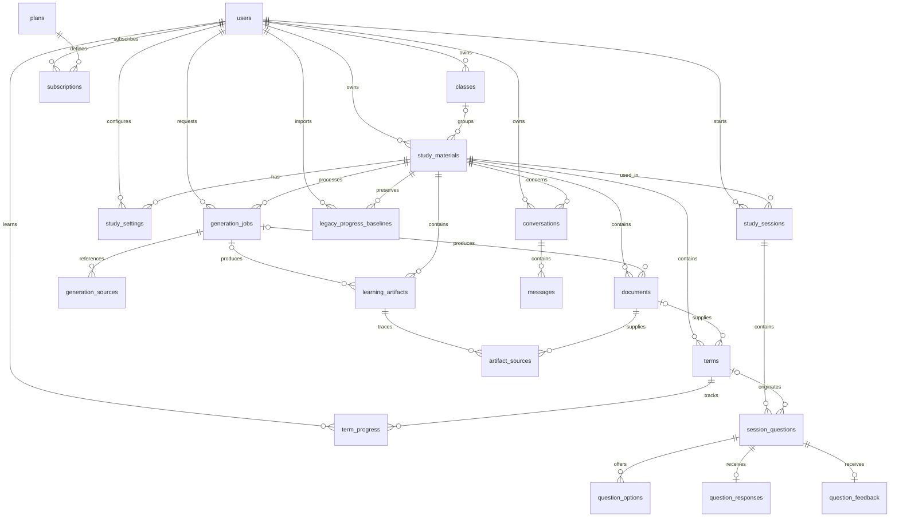
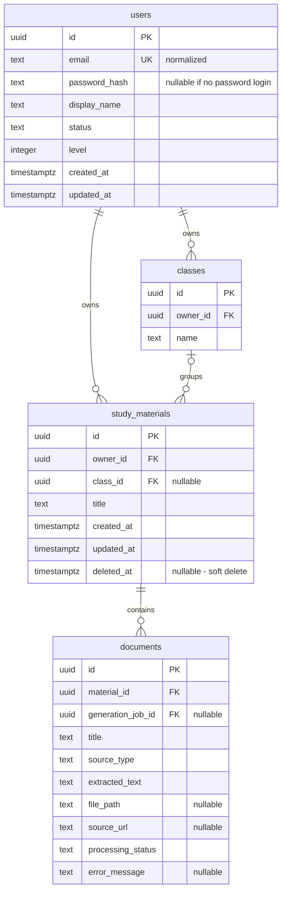
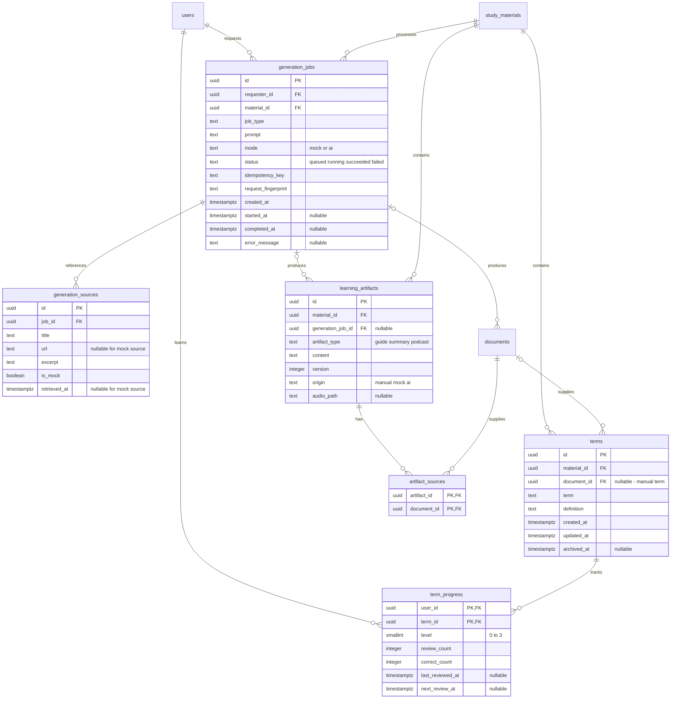
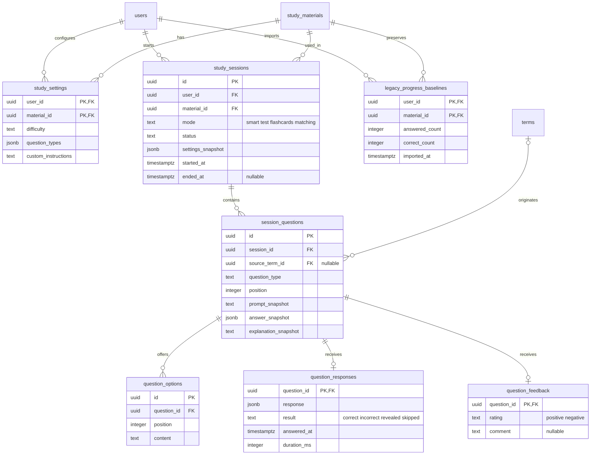
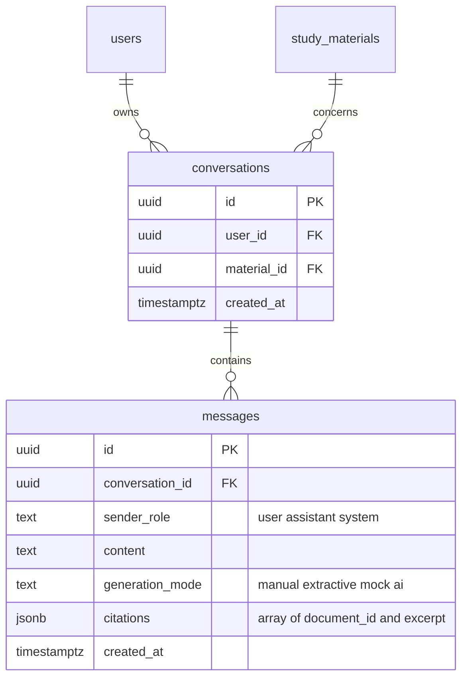

# INS — ERD PostgreSQL (bản lịch sử 21 bảng)

**Trạng thái:** Bản ERD này mô tả phương án cũ 21 bảng và được giữ làm lịch sử. Phương án hiện hành là [plan PostgreSQL 22 bảng](./INS-MINIMAL-DATABASE-PLAN.md), bổ sung `generation_sources`, danh mục `missions` dùng chung và `mission_progress` theo từng user; dùng nguồn cho citations thay cho `messages.citations`, và quy định share nội dung dạng bản sao không kèm tiến độ.

## Cách đọc

- `||`: đúng một; `o|`: không hoặc một; `o{`: không hoặc nhiều.
- `PK`: khóa chính; `FK`: khóa ngoại; `UK`: khóa duy nhất.
- Các cột ghi `nullable` là quan hệ không bắt buộc.
- Tên cột và kiểu dữ liệu dưới đây là đề xuất chi tiết hóa từ plan; chưa phải schema đã được duyệt. Sơ đồ ưu tiên khóa và trường nghiệp vụ chính, không liệt kê mọi trường audit.

## Ghi chú lịch sử

1. Bản gốc thực tế có 23 bảng dù ghi 26. Phương án hiện hành: 23 − 2 bảng được gộp = **21 bảng**.
2. `user_profiles` xuất hiện trong phần ánh xạ nhưng không có trong danh sách bảng. ERD tạm giữ hồ sơ trong `users`, theo nhóm A.
3. Chia sẻ bằng snapshot qua Redis; Redis không nằm trong ERD PostgreSQL và không phát sinh bảng chia sẻ.
4. `messages.sender_role` biểu thị user/assistant/system; người sở hữu hội thoại được xác định qua `conversations.user_id`. Nếu cần lưu nhiều người gửi thật, phải bổ sung `sender_user_id`.
5. `question_feedback` tạm cho tối đa một đánh giá trên mỗi câu hỏi của một phiên; plan chưa chốt số lần phản hồi.

## ERD tổng thể — 21 bảng

## 1. Tài khoản, lớp và thư viện

**Toàn vẹn:** lớp và học liệu phải cùng chủ sở hữu. Học liệu không chọn lớp có `class_id = NULL`. Khóa ngoại đơn trên `class_id` chưa đủ bảo đảm cùng chủ sở hữu; thiết kế vật lý cần khóa ngoại ghép hoặc kiểm tra tương đương.

## 2. Thẻ, tiến độ và tạo nội dung

**Ràng buộc đề xuất:**

- PK ghép `(user_id, term_id)` lưu một tiến độ cho mỗi người/thẻ.
- `0 <= correct_count <= review_count`, `0 <= level <= 3`.
- UNIQUE `(requester_id, idempotency_key)`; so sánh `request_fingerprint` để từ chối cùng khóa nhưng khác yêu cầu.
- UNIQUE `(material_id, artifact_type, version)` nếu phiên bản được đánh số riêng theo loại nội dung.
- Tài liệu/thẻ, tài liệu/job và artifact/job phải cùng học liệu. Các liên kết `artifact_sources` cũng phải bảo đảm điều này.

## 3. Luyện tập, kiểm tra và lịch sử

**Toàn vẹn:** UNIQUE `(session_id, position)` và `(question_id, position)` cho thứ tự câu hỏi/lựa chọn. Một câu chỉ có một đáp án cuối cùng. `answer_snapshot` chứa đáp án chuẩn tại thời điểm tạo câu; `response` chứa lựa chọn/văn bản/cặp ghép của người học. Không lấy đáp án hiện tại của `terms` để chấm lại lịch sử. Thẻ nguồn, nếu có, phải thuộc học liệu của phiên.

Baseline dùng PK ghép người/học liệu để tránh nhập trùng bộ đếm. Mốc chuyển đổi và phạm vi kết quả cũ cần chốt trước khi cộng baseline với lịch sử mới. Không dựng câu hỏi giả cho số tổng cũ.

## 4. Hội thoại và trích dẫn

Citations đã gộp vào messages dưới dạng JSONB; document_id bên trong JSON không được FK trực tiếp kiểm tra. Backend phải xác minh tài liệu trích dẫn tồn tại và thuộc học liệu của hội thoại khi ghi. Quyền xem học liệu không bao gồm quyền xem hội thoại của người khác.

## 5. Gói dịch vụ

```mermaid
erDiagram
    plans {
        uuid id PK
        text code UK
        text name
        text billing_cycle
        bigint price_minor
        text currency
        boolean is_demo
        jsonb features "feature permissions and quotas"
    }
    subscriptions {
        uuid id PK
        uuid user_id FK
        uuid plan_id FK
        timestamptz starts_at
        timestamptz ends_at "nullable"
        text status
        boolean is_mock
    }
    users ||--o{ subscriptions : has_history
    plans ||--o{ subscriptions : defines
```

Một người có nhiều đăng ký trong lịch sử nhưng tối đa một bản ghi `status = active`: cần unique index có điều kiện trên `user_id`. Quyền Plus phải kiểm tra cả thời hạn. Không có Plus hợp lệ thì áp dụng Free. `price_minor >= 0`; nếu có hạn mức trong features thì `quota >= 0`; backend kiểm tra cấu trúc từng quyền lợi. Features là JSON object, citations là JSON array.

## 6. Chia sẻ bằng snapshot qua Redis

Liên kết chia sẻ và snapshot tạm là dữ liệu cache/hạ tầng, không thuộc schema PostgreSQL nên không có bảng hoặc quan hệ trong ERD. Khi người nhận chấp nhận link, backend tạo transaction sao chép học liệu cùng các bản ghi phụ thuộc với UUID mới và `owner_id` là người nhận. Bản sao độc lập; hết hạn hoặc thu hồi token chỉ ngăn nhận thêm, không thu hồi bản sao đã tạo.
## Ghi chú triển khai

- Quan hệ trong sơ đồ không mặc nhiên đồng nghĩa `ON DELETE CASCADE`; chính sách xóa phải chốt theo lịch sử và quyền riêng tư.
- Ưu tiên xóa mềm/lưu trữ học liệu và thẻ. Bản chụp câu hỏi, đáp án và kết quả cần được bảo toàn.
- Các quan hệ phải cùng học liệu/chủ sở hữu cần ràng buộc ghép hoặc cơ chế kiểm tra phù hợp; FK đơn lẻ không đủ.
- Tên lớp duy nhất theo chủ sở hữu và trường màu lớp đã được bổ sung trong migration để khớp frontend.
- Không có bảng `material_shares`; liên kết chia sẻ và snapshot lưu tạm ở Redis khi luồng chia sẻ được triển khai.
